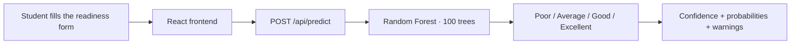

<div align="center">

# PrePilot

### Know if you're interview-ready — before the interview.

**PrePilot** predicts a student's interview readiness — **Poor, Average, Good or Excellent** — from academic results, coding practice and preparation signals, so students can see exactly where they stand before the real interview.


[Quick start](#-quick-start) · [How it works](#-how-it-works) · [Model card](#-model-card) · [API](#-api) · [The SRS vision](#-the-srs-vision--interviewiq-ai-v10) · [Roadmap](#-roadmap) · [Known limitations](#-known-limitations)

</div>

---

## At a glance

| | |
|---|---|
| **What it is** | An interview-readiness predictor with a React frontend and a Python ML API |
| **The model** | Random Forest · 100 trees · 37 features · trained on 60,000 records |
| **Test accuracy** | **92.89%** (Macro F1 **90.38**, baseline 47.11%) |
| **Target roles** | AI/ML Engineer · Data Engineer / Analyst · Full Stack Web Developer · SDE · Technical Support / QA |
| **Frontend** | React 19 + Vite · `react-router-dom` routes: `/`, `/login`, `/register` |
| **Backend** | Python standard-library HTTP API on port 5000 — no framework, no database yet |
| **Author** | Khushboo Kaushik · B.Tech CSE (AIML), GLA University, Greater Noida |

---

## ✨ Quick start

You need **two processes**: the ML API and the frontend.

### 1. ML API — port 5000

```bash
pip install -r requirements.txt
python ml/server.py
```

### 2. Frontend — Vite dev server

```bash
npm install
npm run dev
```

Open the URL Vite prints (default http://localhost:5173). The readiness form calls the ML API at `http://127.0.0.1:5000` by default. To point it elsewhere, copy `.env.example` to `.env` and set `VITE_API_BASE_URL`.

### Other scripts

```bash
npm run build    # production build
npm run preview  # serve the production build
npm run lint     # ESLint
```

---

## 🔮 How it works



1. The student enters their profile — CGPA, DSA score, mock-test scores, target role and more.
2. The form sends it to `POST /api/predict`.
3. The model returns the readiness class, a confidence score, per-class probabilities, inference time — and a warning for every field it had to fill in from training medians, so nothing is silently guessed.

---

## 🧠 Model card

Sourced from `ml/model_metadata.json` — the numbers below are measured, not claimed.

| | |
|---|---|
| Algorithm | RandomForestClassifier — 100 trees, `random_state` 42, stratified split |
| Features | **37** (33 numeric, 4 categorical) |
| Training data | **60,000 records** — 48,000 train / 12,000 held-out test |
| Test accuracy | **92.89%** |
| Macro F1 | **90.38** |
| Weighted F1 | 92.91 |
| Baseline (DummyClassifier) accuracy | 47.11% |
| Supported degrees | B.Tech only |
| Supported target roles | AI/ML Engineer · Data Engineer / Analyst · Full Stack Web Developer · Software Development Engineer (SDE) · Technical Support / QA Engineer |

> **Note:** the training dataset CSV is not committed to this repository, so the model can be served and used, but not retrained from a fresh clone.

---

## 🏗️ Architecture — what is actually built

```
preppilot-frontend/
├── src/                      React frontend (Vite)
│   ├── pages/                Home, Login, Register (react-router-dom routes)
│   ├── components/           Navbar, Hero, Features, PredictorForm, Footer
│   └── lib/                  Browser-local helpers (see "Accounts" below)
├── ml/                       Python ML side
│   ├── server.py             HTTP API on port 5000 (Python standard library only)
│   ├── predict.py            Inference pipeline (validation, imputation, prediction)
│   ├── train_readiness.py    Model training script
│   ├── export_model.py       Exports the .joblib pipeline + metadata
│   ├── model_metadata.json   Feature spec, medians and evaluation metrics
│   └── preppilot_readiness_model.joblib   Trained model pipeline
├── requirements.txt          Python dependencies
└── README.md                 You are here
```

---

## 🔌 API

| Method | Endpoint | Description |
|---|---|---|
| `GET` | `/api/health` | Service status, model name and supported roles |
| `GET` | `/api/roles` | Supported target roles |
| `POST` | `/api/predict` | Readiness prediction for a profile |

`POST /api/predict` accepts a JSON object with any subset of the 37 model features (full list in `ml/model_metadata.json`).

```bash
curl -X POST http://127.0.0.1:5000/api/predict \
  -H "Content-Type: application/json" \
  -d '{"cgpa": 8.4, "dsa_score": 82, "target_role_match": "Software Development Engineer (SDE)"}'
```

<details>
<summary><strong>Example response</strong></summary>

```json
{
  "status": "success",
  "predicted_class": "Good",
  "confidence": 0.81,
  "probabilities": { "Average": 0.09, "Excellent": 0.08, "Good": 0.81, "Poor": 0.02 },
  "target_role": "Software Development Engineer (SDE)",
  "inference_time_ms": 12.4,
  "warnings": ["Missing numeric feature 'age'; defaulted to benchmark median 20.0."],
  "mode": "live_ml"
}
```

</details>

Missing input fields are filled with the training medians by the inference pipeline, and every substitution is reported back in the API response as a warning.

---

## 📘 The SRS vision — InterviewIQ AI v1.0

This project began as a documented specification: **InterviewIQ AI — Intelligent Interview Preparation and Personalized Career Coaching Platform**, Software Requirement Specification v1.0, September 2026 (GLA University). Everything in this section comes from that SRS. It is the vision the product is growing toward — and it is kept separate from what is built today, because the two are not the same yet.

### What the SRS sets out to build

A web platform where students **upload resumes, take AI-driven mock interviews, and receive semantic feedback** on their performance — with skill-gap detection and personalised learning recommendations. It explicitly does **not** provide live human coaching or direct job placement; it focuses on the preparation cycle through automated evaluation and resource recommendation.

**User class:** Candidate — an authenticated student who uploads resumes, takes mock interviews, views performance analytics and accesses recommendations.

### Functional requirements — and where each one stands

| ID | Requirement (SRS) | Status in this repo |
|---|---|---|
| FR-1.1 | Register and log in using **JWT-based authentication** | 🗓️ Planned — Login/Register pages exist; auth is local-only today (see [Accounts](#-accounts--honest-status)) |
| FR-1.2 | Upload a **PDF resume** | 🗓️ Planned |
| FR-1.3 | Extract technical skills from the resume using **spaCy** | 🗓️ Planned |
| FR-1.4 | Reject resume files larger than **5 MB** with a "File size exceeded" error | 🗓️ Planned |
| FR-2.1 | Accept a text-based interview answer; reject empty submissions with an "Answer required" error | 🗓️ Planned |
| FR-2.2 | Return a **semantic similarity score (0–100)** for every valid answer, using Sentence-Transformers | 🗓️ Planned |
| FR-2.3 | Present a **Skill-Gap Analysis** report after a session of at least 5 questions | 🗓️ Planned |
| FR-2.4 | When the NLP service is down, provide a keyword-matching fallback labelled **"Basic Evaluation"** | 🗓️ Planned |
| FR-2.5 | Show improvement trends across the **last 5 interview attempts** | 🗓️ Planned |

### Non-functional requirements

| ID | Requirement (SRS) | Status |
|---|---|---|
| NFR-1 | A semantic similarity score returned **within 3 seconds** | 🗓️ Planned — the current predictor answers in milliseconds (example inference: 12.4 ms) |
| NFR-2 | User passwords stored with **bcrypt** hashing | 🗓️ Planned — no passwords are stored today |
| NFR-3 | All interview attempts recorded, mapped to a unique **UserID** | 🗓️ Planned |
| NFR-4 | **99% uptime** for the database service, so history is never lost | 🗓️ Planned — no database exists yet |

### Architecture as the SRS envisions it

| Component | Responsibility (SRS) |
|---|---|
| Frontend (React) | Profile management and the interview chat window |
| Backend (Node.js) | User authentication, session management, history stored in **PostgreSQL** |
| NLP Services (FastAPI) | Resume processing and answer-similarity evaluation using **Sentence-Transformers** |
| Recommendation Engine | Suggests learning resources based on identified skill gaps |

**Design decisions from the SRS**

| # | Decision | Alternative rejected | Why |
|---|---|---|---|
| D1 | **PostgreSQL** | MongoDB | Relational data is better for mapping scores to specific skills and users for analytics |
| D2 | **Sentence-Transformers** | Keyword matching | Keyword matching fails when a user uses synonyms (e.g. "fast" vs "efficient") |
| D3 | **FastAPI (Python)** for ML | Node.js for ML | Python has superior library support for NLP models like spaCy and SBERT |

**Dependencies (SRS):** HuggingFace Sentence-Transformers for embeddings · Vercel for hosting the frontend · FastAPI on a GPU-enabled instance for NLP inference.

**Constraints (SRS):** C1 — evaluation is limited to technical and HR text-based responses. C2 — the readiness dataset is limited to historical attempts within the platform.

### The dataset the SRS specifies

| Item | Value (SRS) |
|---|---|
| Dataset name | Preppilot Company Interview Preparation & Student Performance Dataset |
| Source | Company-provided / publicly available interview-preparation test kits and job requirements, collected and structured by the Preppilot project team; plus public company career/job descriptions and interview-preparation material (URLs to be documented per source in the dataset metadata) |
| Licence / terms | To be documented per source. Only publicly available data that permits reuse; company-proprietary test questions will not be redistributed; team-created questions marked synthetic / project-generated |
| Size | Target **20,000–30,000 records** (final counts reported after collection, cleaning and deduplication) |
| Prediction target | Company Readiness Score / Readiness Class — **Ready / Almost Ready / Not Ready** for a selected company's recruitment process |
| Task type | Multi-class classification, with a readiness percentage/score as an additional output |
| Primary metric | **Macro F1** — equal importance to Ready, Almost Ready and Not Ready, because misclassifying an under-prepared student as ready gives misleading recommendations |
| Baseline | Most-Frequent-Class baseline (score to be calculated from the final dataset) |
| Known data-quality problems | Duplicate questions, inconsistent difficulty labels, missing answers/options, different question formats across companies, uneven questions per company/topic, synthetic vs real questions, incomplete company-specific requirements — handled during preprocessing |

> **The one honest twist.** The SRS lists the Random Forest interview-readiness predictor as *deliberately not in the MVP* — it needed a large volume of user data that would not be available in the first sprint. In practice the build order flipped: the predictor, trained on 60,000 records, became the working core first, while the NLP, auth and resume scope above is the next phase. This README keeps both stories visible instead of pretending they are one.

### Acceptance criteria (SRS)

- **AC-1** — Log in with valid credentials → redirected to the Interview Dashboard.
- **AC-2** — Uploading a resume correctly populates the "Skills" section of the user profile.
- **AC-3** — Submitting a correct answer that uses different words than the reference answer still scores high (> 0.8 similarity).
- **AC-4** — Attempting an interview without logging in redirects back to the login page.

### Out of scope for this release (SRS)

- Video interview analysis (real-time facial expression and body language)
- Payment gateway / subscription models for premium coaching
- Live recruiter portal (direct communication with real-world recruiters)

### Project timeline (SRS build plan)

| Stage | Deliverable | Date |
|---|---|---|
| Development Sprint I | Prototype / initial working model | 27 Sep 2026 |
| Development Sprint II | 50% functional application | 17 Oct 2026 |
| Development Sprint III | 75–80% functional application | 7 Nov 2026 |
| **Testing & Validation** | Test report and bug log | **17 Nov 2026** |
| **Deployment & Documentation** | Deployed application, user manual, technical documentation | **30 Nov 2026** |
| Final Presentation | Final report, presentation and viva | 5–10 Dec 2026 |

---

## 🗺️ Roadmap

Drawn from the SRS MVP and the build plan — in dependency order:

1. ✅ **Readiness predictor, end to end** — the working core (this repo, today)
2. 🗓️ **Real accounts** — JWT auth + bcrypt (FR-1.1, NFR-2), replacing the local-only sign-in
3. 🗓️ **Resume upload + spaCy skill extraction** (FR-1.2, FR-1.3, FR-1.4)
4. 🗓️ **NLP mock interviews** — semantic similarity scoring (FR-2.1, FR-2.2), with the "Basic Evaluation" fallback (FR-2.4)
5. 🗓️ **Skill-gap reports and recommendations** (FR-2.3) and trend views across the last 5 attempts (FR-2.5)
6. 🗓️ **Persistence** — Node.js + PostgreSQL backend (D1), history and analytics (NFR-3, NFR-4)
7. 🗓️ **Deployment** — Vercel frontend, FastAPI NLP service (per the SRS plan, by 30 Nov 2026)

---

## 👤 Accounts — honest status

PrePilot has **no account server yet**. The Login and Register pages validate the form in the browser and keep the sign-in in `localStorage` on the user's own device only. No account is created on a server, no password is stored or sent anywhere, and no page claims otherwise. When a real auth backend exists (FR-1.1), `src/lib/localUser.js` is the single place to replace.

---

## ⚠️ Known limitations

- The model cannot be retrained from this repository (dataset not committed).
- `ml/server.py` reports `records_evaluated: 60000` in its `model_info` block; the held-out evaluation actually used the 12,000-record test split recorded in `ml/model_metadata.json`.
- The frontend has no automated test suite yet; verification is lint + production build + manual/API smoke tests.
- The SRS classes (Ready / Almost Ready / Not Ready) and the model classes (Poor / Average / Good / Excellent) are different label schemes — they will need one agreed mapping when the two scopes merge.

---

## 📄 Project

**Author:** Khushboo Kaushik — B.Tech Computer Science & Engineering (AIML), GLA University, Greater Noida · Roll No. 22515500046 · Section NE

**Specification:** InterviewIQ AI — Software Requirement Specification, Version 1.0, September 2026.

Contributions are welcome — please keep changes focused, verify the build (`npm run build`) and the ML endpoints before opening a pull request, and do not add secrets, datasets or credentials to the repository.
